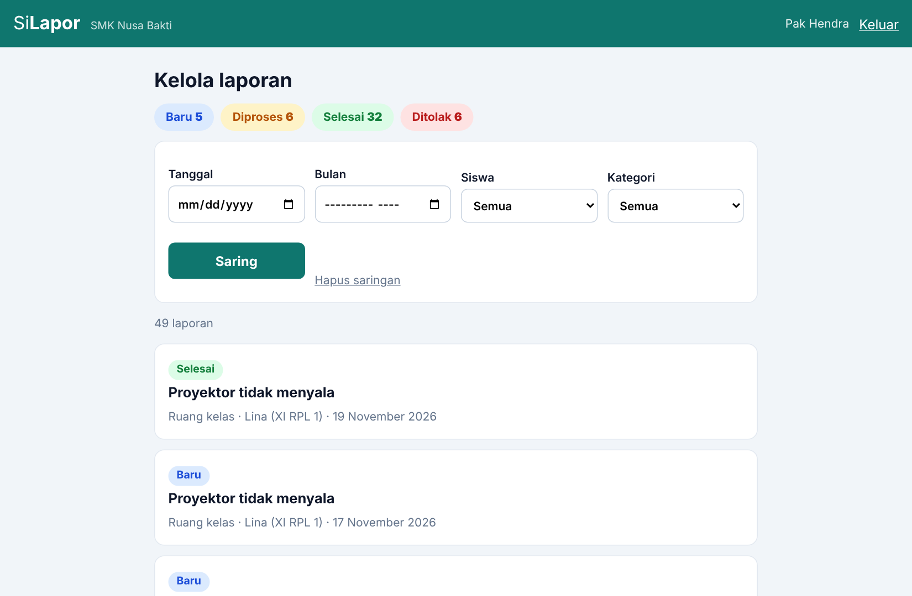
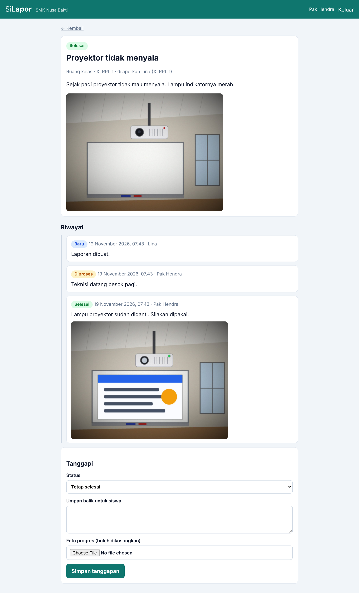
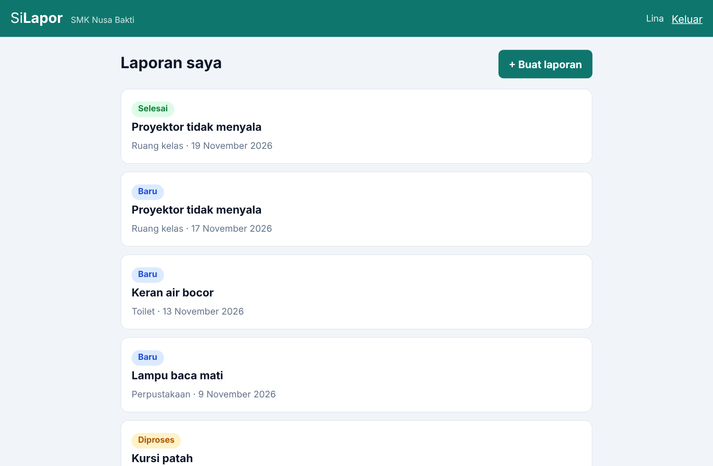
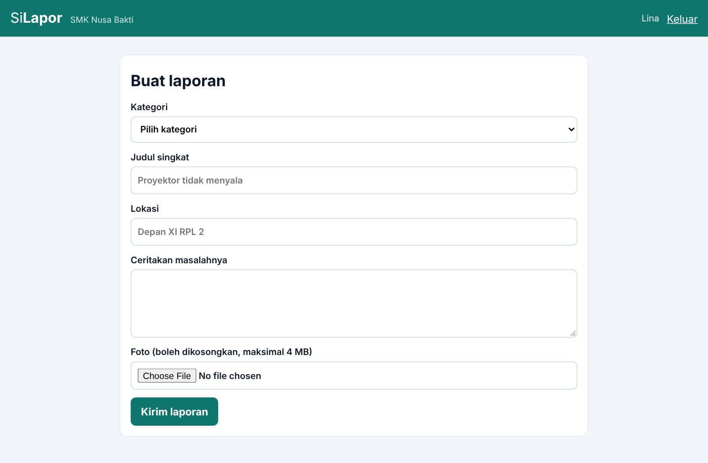
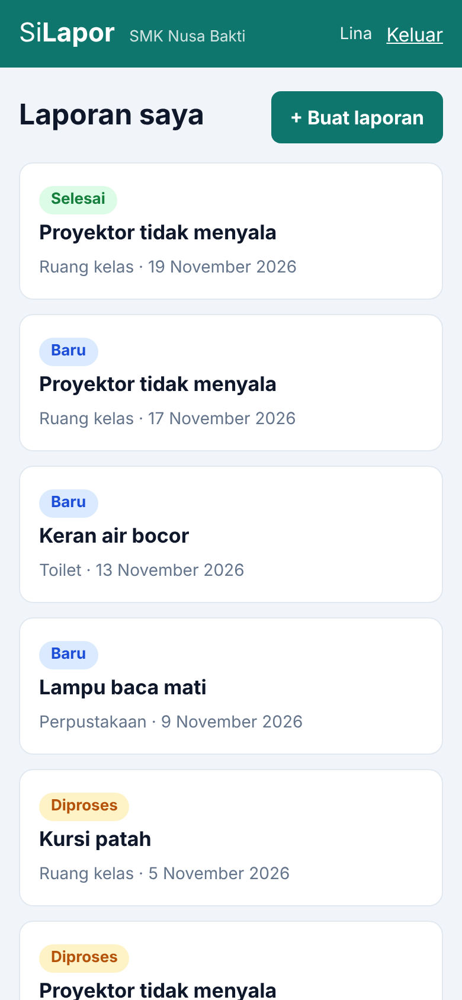
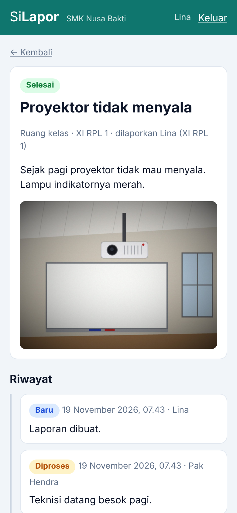

# SiLapor

SiLapor adalah aplikasi pengaduan sarana dan prasarana sekolah. Siswa memotret fasilitas yang rusak lalu mengirim laporannya dari HP. Petugas sarana prasarana membalas, mengubah status laporan, dan mengunggah foto setelah perbaikan selesai. Siswa bisa memantau semua itu dari HP-nya sendiri.

Aplikasi ini dibangun dari nol, langkah demi langkah, di video **"Membangun Aplikasi Laravel dari Nol: Lapor Sarana Sekolah"** di kanal YouTube [@iTeachSWE](https://www.youtube.com/@iTeachSWE). Repositori ini berisi kode lengkapnya, ditambah semua perintah yang di video hanya disebut sekilas.

Dibuat dengan Laravel 13, PHP 8.3, MySQL 8, dan Blade. Tidak ada framework JavaScript.

## Tampilan

Semua gambar di bawah ini diambil dari aplikasi yang sedang berjalan, dengan data contoh dari `ContohSeeder`.

**Halaman petugas.** Pak Hendra melihat rekap per status, menyaring laporan, lalu menanggapinya.

| Daftar dan saringan | Detail, riwayat, dan form tanggapan |
| --- | --- |
|  |  |

**Halaman siswa.** Lina melihat laporannya sendiri dan mengirim laporan baru beserta fotonya.

| Laporan saya | Buat laporan |
| --- | --- |
|  |  |

**Di HP.** Tampilannya menyesuaikan layar kecil, jadi siswa bisa memantau laporannya dari mana saja.

<p>
  
  
</p>

## Isi

1. [Yang bisa dilakukan aplikasi ini](#yang-bisa-dilakukan-aplikasi-ini)
2. [Memasang alat](#memasang-alat)
3. [Menjalankan SiLapor di komputermu](#menjalankan-silapor-di-komputermu)
4. [Mencoba dari HP](#mencoba-dari-hp)
5. [Mengikuti video bab demi bab](#mengikuti-video-bab-demi-bab)
6. [Menjalankan test](#menjalankan-test)
7. [Memasang di server](#memasang-di-server)
8. [Tantangan](#tantangan)
9. [Daftar periksa kode buatan AI](#daftar-periksa-kode-buatan-ai)
10. [Kalau ada masalah](#kalau-ada-masalah)

## Yang bisa dilakukan aplikasi ini

Untuk siswa:

- Mendaftar dan masuk dengan email dan kata sandi.
- Mengirim laporan berisi judul, kategori, lokasi, uraian, dan satu foto.
- Melihat daftar laporannya sendiri beserta statusnya.
- Membaca riwayat tanggapan petugas, lengkap dengan foto hasil perbaikan.

Untuk petugas (admin):

- Melihat semua laporan, dengan saringan status, kategori, dan rentang tanggal.
- Menanggapi laporan dan mengubah statusnya mengikuti alur `baru` → `diproses` → `selesai`, atau `ditolak`.
- Melihat rekap jumlah laporan per kategori.

Hal yang dijaga oleh kodenya:

- Seorang siswa tidak bisa membuka laporan milik siswa lain (policy).
- Halaman petugas hanya bisa dibuka oleh admin (middleware).
- Foto diperiksa isinya, ditulis ulang sebagai JPEG baru, dan disimpan di folder yang tidak bisa dibuka langsung dari browser.
- Status tidak bisa melompat, misalnya dari `selesai` kembali ke `baru`.
- Percobaan login dibatasi lima kali per menit.

## Memasang alat

Kamu membutuhkan PHP 8.3 atau lebih baru, Composer, MySQL 8, Git, dan sebuah editor kode. Di video kita memakai VS Code.

### Windows dan Mac

1. **Laravel Herd** memasang PHP, Composer, dan Node.js sekaligus. Unduh dari <https://herd.laravel.com>, jalankan penginstalnya, lalu buka Herd satu kali.
2. **MySQL**. Di Windows, unduh MySQL Installer dari <https://dev.mysql.com/downloads/installer/>, pilih *Server only*, lalu buat kata sandi untuk `root` dan catat. Di Mac, unduh berkas DMG dari <https://dev.mysql.com/downloads/mysql/>.
3. **Git** dari <https://git-scm.com>, dengan pilihan bawaan.
4. **VS Code** dari <https://code.visualstudio.com>.

### Linux (Ubuntu atau Debian)

```bash
sudo apt update
sudo apt install php php-cli php-mysql php-gd php-xml php-mbstring php-curl php-zip php-sqlite3 unzip
sudo apt install composer mysql-server git
```

Kalau versi PHP dari `apt` lebih lama dari 8.3, pasang PHP lewat <https://php.new> dengan mengikuti petunjuk di halaman itu.

### Memeriksa hasilnya

Buka terminal baru (di VS Code: menu *Terminal*, *New Terminal*), lalu ketik:

```bash
php --version
composer --version
mysql --version
git --version
```

Keempatnya harus menjawab dengan nomor versi.

### Kalau `mysql` tidak dikenali di Windows

Artinya Windows belum tahu letak program `mysql`. Cara mengatasinya:

1. Buka menu Start, ketik **environment variables**, lalu pilih *Edit the system environment variables*.
2. Klik *Environment Variables*, pilih baris **Path** di bagian atas, lalu klik *Edit*.
3. Klik *New*, lalu isi `C:\Program Files\MySQL\MySQL Server 8.4\bin`. Sesuaikan angkanya dengan folder yang ada di komputermu.
4. Klik *OK* sampai semua jendela tertutup, tutup VS Code, lalu buka lagi.

## Menjalankan SiLapor di komputermu

Bagian ini untuk kamu yang ingin langsung menjalankan versi jadinya. Kalau kamu mengikuti video dari awal, kamu membuat proyeknya sendiri di bab satu.

**1. Ambil kodenya.**

```bash
git clone https://github.com/listyantidewi1/SiLapor.git silapor
cd silapor
composer install
```

**2. Buat database dan penggunanya.** Masuk ke MySQL sebagai root dengan `mysql -u root -p`, lalu ketik:

```sql
CREATE DATABASE silapor;
CREATE USER 'silapor'@'localhost' IDENTIFIED BY 'gantiSandiIni!';
GRANT ALL PRIVILEGES ON silapor.* TO 'silapor'@'localhost';
EXIT;
```

Ganti `gantiSandiIni!` dengan kata sandimu sendiri. Aplikasi sengaja tidak memakai akun `root`, supaya kalau kata sandinya bocor, yang terbuka hanya satu database ini.

**3. Siapkan berkas `.env`.**

```bash
cp .env.example .env
php artisan key:generate
```

Di Windows, pakai `copy .env.example .env`. Lalu buka `.env` dan sesuaikan bagian database:

```ini
DB_CONNECTION=mysql
DB_DATABASE=silapor
DB_USERNAME=silapor
DB_PASSWORD="gantiSandiIni!"
```

Berkas `.env` berisi kata sandi, jadi berkas itu tidak pernah ikut ke GitHub.

**4. Buat tabel dan isi data contoh.**

```bash
php artisan migrate --seed
php artisan db:seed --class=ContohSeeder
```

Perintah pertama membuat tabel, enam kategori, dan tiga akun. Perintah kedua menambah 48 laporan contoh supaya saringan dan rekap punya isi.

**5. Jalankan.**

```bash
php artisan serve
```

Buka <http://localhost:8000> di browser.

### Akun contoh

| Nama | Email | Peran |
| --- | --- | --- |
| Pak Hendra | `hendra@nusabakti.test` | admin (petugas) |
| Lina | `lina@nusabakti.test` | siswa |
| Dimas | `dimas@nusabakti.test` | siswa |

Kata sandi ketiganya adalah `rahasia123`. Kata sandi ini diketahui semua orang, jadi **ganti sebelum aplikasi dipakai sungguhan**.

## Mencoba dari HP

Laptop dan HP harus tersambung ke WiFi yang sama.

1. Jalankan server supaya bisa dijangkau perangkat lain:

   ```bash
   php artisan serve --host 0.0.0.0
   ```

2. Cari alamat IP laptopmu. Di Windows, ketik `ipconfig` dan lihat baris *IPv4 Address*. Di Mac atau Linux, ketik `ip addr` atau `ifconfig`.
3. Di browser HP, ketik alamat itu diikuti `:8000`, misalnya `192.168.1.23:8000`.

Kalau halamannya tidak terbuka, biasanya firewall laptop yang menghalangi. Izinkan PHP saat Windows bertanya, atau izinkan port 8000.

## Mengikuti video bab demi bab

Setiap akhir bab diberi tag, jadi kamu bisa melihat kode persis seperti di akhir bab itu:

```bash
git checkout bab-04
```

| Tag | Isi |
| --- | --- |
| `bab-01` | Proyek Laravel baru yang tersambung ke MySQL |
| `bab-04` | Migration, model, dan seeder |
| `bab-05` | Daftar, login, logout, dan pemisahan peran |
| `bab-06` | Form laporan dan upload foto |
| `bab-07` | Halaman petugas: saringan, rekap, dan tanggapan |
| `bab-08` | Halaman siswa dan policy |
| `bab-09` | Test otomatis |

Bab dua dan tiga berisi kebutuhan dan rancangan data, jadi tidak ada kode baru. Untuk kembali ke versi terakhir, ketik `git checkout main`.

Beberapa berkas di video tidak diketik, melainkan disalin dari repositori ini:

| Berkas | Dipakai di |
| --- | --- |
| `public/css/gaya.css` | Bab 5 |
| `database/seeders/ContohSeeder.php` | Bab 4 |
| folder `lang/id` | Bab 6, supaya pesan validasi berbahasa Indonesia |
| `tests/Feature/LaporanTest.php` | Bab 9, test selengkapnya |

## Menjalankan test

```bash
php artisan test
```

Test berjalan di database SQLite sementara di dalam memori, jadi data di MySQL tidak tersentuh. Test memeriksa aturan yang akibatnya berat kalau rusak, yaitu privasi laporan, hak akses halaman petugas, alur status, dan upload foto.

## Memasang di server

Kamu membutuhkan server Linux (VPS sewaan atau komputer server di sekolah) dan sebuah nama domain yang sudah diarahkan ke alamat IP server itu. Contoh di bawah memakai Ubuntu 24.04 dan domain `silapor.sekolahmu.sch.id`.

**1. Masuk dan pasang alat.**

```bash
ssh admin@silapor.sekolahmu.sch.id
sudo apt update
sudo apt install nginx mysql-server composer git
sudo apt install php-fpm php-mysql php-gd php-xml php-mbstring php-curl php-zip
```

**2. Buat database dan penggunanya**, sama seperti di komputermu, tetapi dengan kata sandi yang berbeda. Masuk dengan `sudo mysql`.

**3. Ambil kodenya.**

```bash
cd /var/www
sudo git clone https://github.com/listyantidewi1/SiLapor.git silapor
sudo chown -R $USER:$USER silapor
cd silapor
composer install --no-dev
```

**4. Siapkan `.env`.**

```bash
cp .env.example .env
nano .env
```

```ini
APP_NAME=SiLapor
APP_ENV=production
APP_DEBUG=false
APP_URL=https://silapor.sekolahmu.sch.id

DB_CONNECTION=mysql
DB_DATABASE=silapor
DB_USERNAME=silapor
DB_PASSWORD="kataSandiServer"
```

`APP_DEBUG` harus `false`. Kalau `true`, setiap error menampilkan potongan kode dan isi pengaturan kepada pengunjung.

**5. Kunci, tabel, dan data awal.**

```bash
php artisan key:generate
php artisan migrate --force
php artisan db:seed --force
```

Setelah itu, masuk sebagai Pak Hendra dan **ganti kata sandinya**, atau ubah akun admin di `database/seeders/DatabaseSeeder.php` sebelum menjalankan seeder.

**6. Izin folder.** Hanya dua folder yang perlu bisa ditulis oleh web server:

```bash
sudo chown -R www-data:www-data storage bootstrap/cache
```

Jangan pernah memakai `chmod -R 777`. Perintah itu mengizinkan siapa pun di server mengubah semua berkas, termasuk kode aplikasinya.

**7. Nginx.** Buat berkas `/etc/nginx/sites-available/silapor`:

```nginx
server {
    server_name silapor.sekolahmu.sch.id;
    root /var/www/silapor/public;
    index index.php;

    client_max_body_size 5m;

    location / {
        try_files $uri $uri/ /index.php?$query_string;
    }
    location ~ \.php$ {
        fastcgi_pass unix:/run/php/php8.3-fpm.sock;
        include fastcgi.conf;
    }
}
```

Baris `root` harus menunjuk ke folder `public`, bukan ke folder proyeknya. Kalau salah, berkas `.env` bisa diunduh siapa saja. Lalu aktifkan:

```bash
sudo ln -s /etc/nginx/sites-available/silapor /etc/nginx/sites-enabled/
sudo nginx -t
sudo systemctl reload nginx
```

**8. HTTPS.** Aplikasi yang punya halaman login wajib memakai HTTPS.

```bash
sudo apt install certbot python3-certbot-nginx
sudo certbot --nginx
```

Certbot memperpanjang sertifikatnya secara otomatis.

**9. Percepat dan jadwalkan backup.**

```bash
php artisan optimize
crontab -e
```

```cron
# setiap malam pukul 01.00
0 1 * * * mysqldump silapor > /backup/silapor-$(date +\%F).sql
5 1 * * * tar czf /backup/foto-$(date +\%F).tgz /var/www/silapor/storage/app/private
```

Backup yang disimpan di server yang sama ikut hilang kalau servernya rusak. Salin hasilnya ke komputer lain atau ke penyimpanan cloud.

**Memperbarui aplikasi** setelah ada perubahan kode:

```bash
cd /var/www/silapor
git pull
composer install --no-dev
php artisan migrate --force
php artisan optimize
```

## Tantangan

Setiap bab di video ditutup dengan satu tantangan. Kerjakan sendiri dulu sebelum bertanya kepada AI.

1. **Bab 2.** Tulis tiga kalimat "sebagai …, saya ingin …, supaya …" untuk aplikasi yang ingin kamu buat sendiri.
2. **Bab 3.** Tambahkan satu tabel ke rancangan supaya satu laporan bisa punya lebih dari satu foto.
3. **Bab 4.** Tulis query yang menghitung jumlah laporan per kategori, diurutkan dari yang terbanyak.
4. **Bab 5.** Buat halaman supaya pengguna bisa mengganti kata sandinya sendiri.
5. **Bab 6.** Batasi supaya satu siswa hanya bisa mengirim lima laporan per hari.
6. **Bab 7.** Tambahkan tombol untuk mengunduh daftar laporan yang sedang tampil sebagai berkas CSV.
7. **Bab 8.** Izinkan siswa membatalkan laporannya sendiri, tetapi hanya selama statusnya masih `baru`.

## Daftar periksa kode buatan AI

Setiap bab di video punya segmen "Cek kerjaan AI". Semua pelajarannya dirangkum menjadi satu daftar di [docs/daftar-periksa-kode-ai.md](docs/daftar-periksa-kode-ai.md). Pakailah daftar itu setiap kali AI menyodorkan kode kepadamu.

## Kalau ada masalah

| Gejala | Penyebab yang paling sering |
| --- | --- |
| `command not found` setelah memasang alat | Terminal dibuka sebelum alat terpasang. Tutup VS Code, lalu buka lagi. |
| `SQLSTATE[HY000] [1045] Access denied` | Nama pengguna atau kata sandi di `.env` tidak cocok dengan yang dibuat di MySQL. |
| `SQLSTATE[HY000] [2002] Connection refused` | MySQL belum berjalan. Jalankan layanannya lebih dulu. |
| `No application encryption key has been specified` | Belum menjalankan `php artisan key:generate`. |
| Halaman 419 saat mengirim form | Baris `@csrf` di dalam form terlewat. |
| Foto ditolak padahal berkasnya gambar | Ekstensi GD belum aktif. Periksa dengan `php -m` dan cari `gd`. |
| Foto besar gagal diunggah di server | Naikkan `upload_max_filesize` dan `post_max_size` di `php.ini`, lalu muat ulang PHP-FPM. |
| `permission denied` di server | Izin folder `storage` atau `bootstrap/cache` belum diatur. Lihat langkah 6 di atas. |

## Lisensi

Kode di repositori ini boleh dipakai, diubah, dan dibagikan untuk belajar dan mengajar. Kerangka Laravel berlisensi [MIT](https://opensource.org/licenses/MIT).
